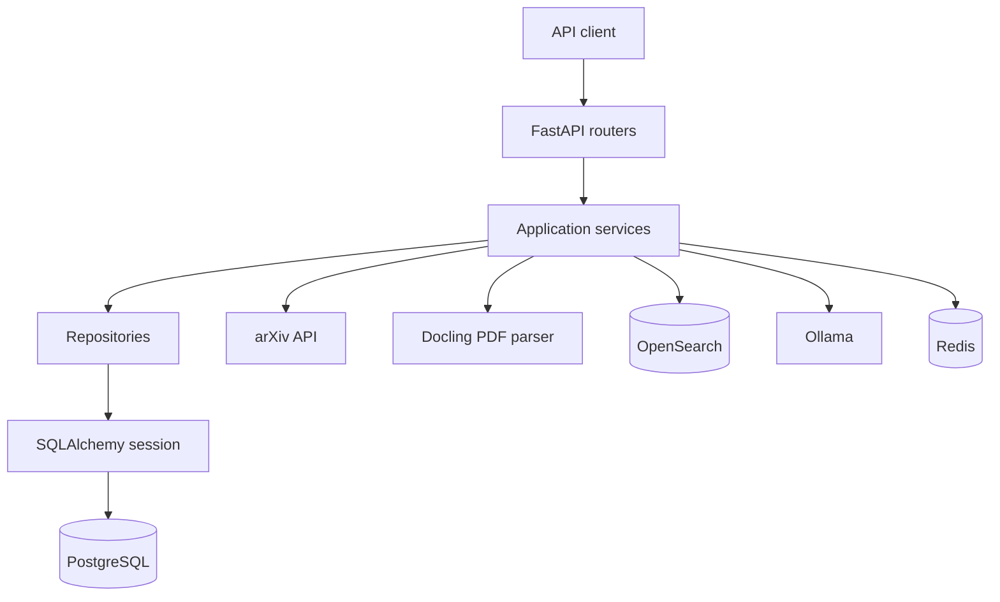
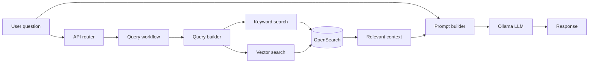
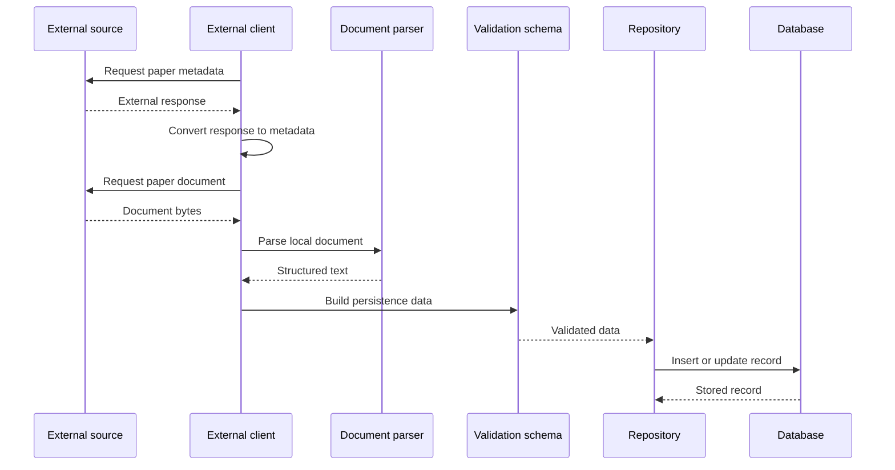
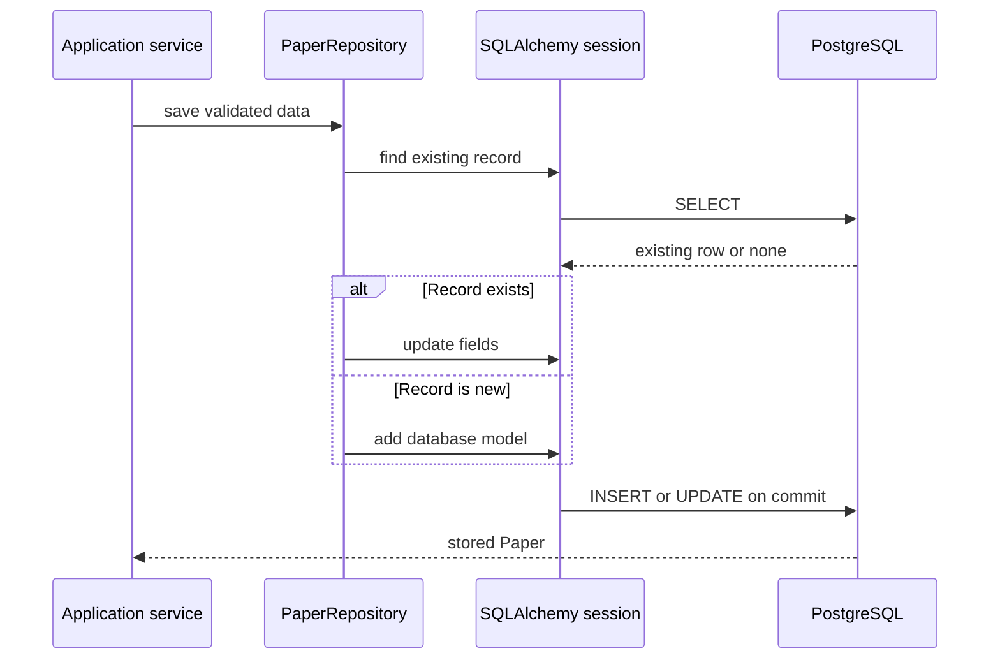

# arXiv Paper Curator — Production RAG System

A production-style Retrieval-Augmented Generation (RAG) system for research
papers. It ingests papers from arXiv, turns their PDFs into structured text,
stores them in PostgreSQL, indexes them for keyword and semantic search, and
answers research questions with a locally hosted LLM, citing the papers it
used.

## What It Supports

- **Paper ingestion** — fetch the latest papers for an arXiv category
  (default `cs.AI`), optionally within a date range, with rate limiting and
  retries.
- **PDF understanding** — convert PDFs into structured sections with
  Docling; oversized or unparseable PDFs are skipped without blocking the
  rest of a batch.
- **Durable storage** — idempotent upserts into PostgreSQL, so re-running
  ingestion never creates duplicates.
- **Keyword search** — BM25 over title, abstract, and full text, with field
  boosting, category filters, and highlighted matches.
- **Semantic and hybrid search** — section-aware chunking, vector
  embeddings, and Reciprocal Rank Fusion to combine keyword and vector
  results.
- **Grounded question answering** — retrieval-augmented answers from a local
  LLM (Ollama) with source attribution, as standard or streaming responses.
- **Production features** — Redis response caching, Langfuse tracing, and
  health checks.
- **Agentic retrieval** — a LangGraph workflow that screens questions,
  grades retrieved documents, and rewrites weak queries.
- **Telegram interface** — optionally ask questions from a phone.

## How It Works

1. **Ingest** — `ArxivClient` queries the arXiv API (rate-limited to arXiv's
   guideline of one request every 3 seconds, with retries) and downloads each
   paper's PDF into a local cache.
2. **Parse** — Docling reads the PDF and returns structured sections plus the
   full text.
3. **Store** — metadata and parsed text are validated and upserted into
   PostgreSQL.
4. **Index** — papers, and their text chunks with embeddings, are indexed in
   OpenSearch.
5. **Retrieve** — a question is matched with BM25 keyword search, vector
   search, or both fused together.
6. **Generate** — the retrieved context is assembled into a prompt and
   answered by the local LLM, with caching and tracing around this path.

The diagrams below show the layers, the data flow, and how a single paper
moves through the system.

## Architecture and Design

### Layered Architecture



- **Routers** receive HTTP requests and return validated responses.
- **Services** coordinate workflows across external systems and storage.
- **Repositories** contain database queries and persistence logic.
- **Models** describe database tables; **schemas** describe validated data
  entering or leaving the application.
- **Clients** isolate communication with arXiv, OpenSearch, Ollama, and
  other external services.

### Data Flow View

The ingestion path moves information from external sources into durable
application data:

```mermaid
flowchart LR
  Runner[Application workflow] --> Fetcher[Workflow orchestrator]
  Fetcher --> ArxivClient[ArxivClient]
  ArxivClient --> ExternalAPI[External content API]
  ExternalAPI --> Metadata[Validated metadata]

  Metadata --> Download[Download PDF]
  Download --> Cache[(PDF cache)]
  Cache --> Parser[Document parser]
  Parser --> Parsed[Structured document]

  Metadata --> Create[PaperCreate]
  Parsed --> Create
  Create --> Repository[PaperRepository]
  Repository --> Database[(Database)]
```



The data changes shape as it moves through the system:

```text
external response
  -> validated metadata
  -> local document
  -> parsed document
  -> persistence schema
  -> database row
```

The orchestrator coordinates the workflow, while each client, parser, and
repository owns one type of work. A failure in one item should be isolated
when the workflow processes a batch.

### Query Flow

The query path combines retrieval with response generation:



### One Paper's Lifecycle



The lifecycle shows the movement of one item. The layered view shows who
owns each responsibility; this view shows the order in which the work
happens.

### Persistence Boundary



The session owns the transaction boundary. The repository owns the query,
and the service decides when the operation should happen.

### Responsibility View

```text
External clients:
  communicate with outside systems

Application services:
  coordinate workflows

Parsers and transformers:
  convert data between representations

Repositories:
  read and write durable data

Schemas:
  validate boundaries between layers

Models:
  represent persisted data

Each layer depends on the layer below it through a small, explicit
interface rather than reaching into unrelated implementation details.
```

## Tech Stack

| Area | Technology |
|---|---|
| API | Python 3.12, FastAPI, Pydantic |
| Storage | PostgreSQL 16, SQLAlchemy |
| Search | OpenSearch 2.19 (BM25 + k-NN vectors) |
| Document parsing | Docling |
| Embeddings | Jina AI |
| LLM | Ollama (local models) |
| Caching & observability | Redis, Langfuse |
| Agents | LangGraph |
| Scheduling | Apache Airflow 2.10 |
| Tooling | Docker Compose, uv |

## Getting Started

Requirements: Python 3.12, [uv](https://docs.astral.sh/uv/), and Docker Desktop.

```bash
uv sync
cp .env.example .env
docker compose up -d      # Postgres, OpenSearch, Ollama, Redis, Airflow, Langfuse
uv run uvicorn src.main:app --reload --port 8100
```

The API docs are then available at <http://localhost:8100/docs>. The first
`docker compose up -d` takes a few extra minutes because it builds the Airflow
image. `.env.example` already points at the local services; `JINA_API_KEY` is
needed for embeddings, and the Langfuse and Telegram keys are optional.

`scripts/` contains an end-to-end check for each stage of the system, for
example:

```bash
uv run python scripts/week1_verify_infra.py         # services reachable
uv run python scripts/week2_test_arxiv_pipeline.py  # arXiv -> PDF -> PostgreSQL
```

## Project Structure

```
compose.yml                    # local infrastructure (Docker Compose)
airflow/                       # Airflow image: Dockerfile and entrypoint
docs/                          # design notes
scripts/                       # end-to-end check for each stage
src/
├── main.py                    # FastAPI application entrypoint
├── config.py                  # typed settings loaded from .env
├── routers/                   # HTTP endpoints
├── services/
│   ├── arxiv/                 # rate-limited arXiv API client
│   ├── pdf_parser/            # Docling PDF parsing
│   ├── metadata_fetcher.py    # ingestion orchestrator
│   ├── opensearch/            # index mappings, query builders, client
│   ├── indexing/              # chunking and indexing pipeline
│   ├── embeddings/            # Jina embeddings client
│   ├── ollama/                # local LLM client and prompts
│   ├── cache/                 # Redis response cache
│   ├── agents/                # LangGraph agentic RAG workflow
│   ├── langfuse_tracer.py     # pipeline tracing
│   └── telegram_bot.py        # Telegram bot integration
├── repositories/              # database access
├── models/                    # SQLAlchemy models
├── schemas/                   # Pydantic schemas
└── db/                        # engine, sessions, table creation
```

## Project Status

- **Implemented:** local infrastructure, FastAPI app and configuration, the
  ingestion pipeline (arXiv → Docling → PostgreSQL), the papers API, and the
  OpenSearch index mappings and BM25 query builders.
- **In development:** the OpenSearch client and keyword search endpoint.
- **Next:** chunking and embeddings, hybrid search, RAG answers, caching and
  tracing, and the agentic workflow.

## Acknowledgements

This project follows the architecture of the **arXiv Paper Curator** from the
[Production Agentic RAG course](https://github.com/jamwithai/production-agentic-rag-course)
by Jam With AI, created by Shirin Khosravi Jam and Shantanu Ladhwe and released
under the MIT License. The local infrastructure setup (the Docker Compose
service definitions and the Airflow image) is adapted from that project.
